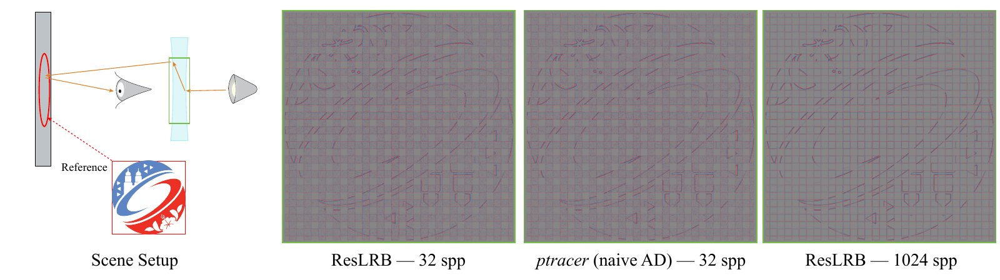

# Stochastic Graph Compression for Constant-Memory Differentiable Light Tracing

Linas Beresna and Eugene Fiume, SIGGRAPH Asia 2026 Technical Communications

[Project page](https://www.linasberesna.com/views/sigasia2026-reslrb.html) | [Paper](https://www.linasberesna.com/files/papers/SIGASIA-ResLRB.pdf)



ResLRB (Reservoir Light Replay Backpropagation) differentiates a light tracer with memory that is constant in path length. Each light path keeps one of its sensor connections in a weighted reservoir, and the adjoint pass replays the path and backpropagates through that connection only.

## Setup

```
pip install -r requirements.txt
scripts/download_scenes.sh
```

The living room is [The Grey & White Room](https://benedikt-bitterli.me/resources/) by Wig42, from Benedikt Bitterli's rendering resources. The download script fetches its meshes and textures.

## Usage

Importing `reslrb` registers two Mitsuba integrators:

- `reslrb` for detached gradients (the sensor position of a connection does not move)
- `reslrb_attached` for attached gradients (it does, as in the caustic)

```python
import mitsuba as mi
mi.set_variant("cuda_ad_rgb")
import reslrb

integrator = mi.load_dict({"type": "reslrb", "max_depth": 16})
image = mi.render(scene, params, spp=32, integrator=integrator)
```

Both support `mi.render` and `dr.backward`, but not forward-mode differentiation.

## Figures

To regenerate the figures of the paper into `figures/`:

```
scripts/paper_figures.sh
```

| Figure | Script |
| --- | --- |
| 1, caustic gradients | `caustic.py` |
| 5, gradient validation | `target.py`, then `validate.py` |
| 6, memory and time | `sweep.py`, then `plot_sweep.py` |

Figures 2 and 3 are diagrams and Figure 4 is pseudocode. `assets/sweep_paper.json` holds the measurements behind Figure 6, so `python plot_sweep.py assets/sweep_paper.json` redraws it without a GPU.

## Tested on

- Pop!_OS 24.04, NVIDIA RTX 5080 (16 GB), Python 3.12 (the paper)
- macOS, Apple silicon, Python 3.15

On Linux with an NVIDIA GPU, Mitsuba uses the `cuda_ad_rgb` variant and `sweep.py` reports peak GPU memory. Otherwise it uses `llvm_ad_rgb` and reports the peak memory of the process, which includes the overhead of the LLVM backend. The times and memory of the paper were measured on the GPU.
